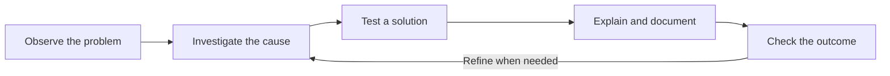

# Shivakumar Meesala
### THE CONNECTION · Where technology meets people.

Electrical engineering graduate connecting power electronics,
embedded systems and practical troubleshooting with clear
customer communication.

[Explore my portfolio](https://shivakumarmeesala.space/) ·
[LinkedIn](https://www.linkedin.com/in/meesala-shiva-kumar-447543341) ·
[Email me](mailto:Meesalashivakumar12@gmail.com)

---

## Start here — 30 seconds

- **Engineering:** MSc Electrical and Electronics Engineering,
  University of Greenwich.
- **People:** Customer support experience at Amazon Development
  Center and B&M Bargains.
- **Now:** Pursuing MSc Project Planning and Management,
  University of Bradford.
- **Looking for:** Electrical engineering, embedded systems
  and technical support opportunities.
- **Based in:** London, UK.

## Choose your connection

| Your hiring focus | Explore my work |
| :--- | :--- |
| Power & electronics | Solar PV, MPPT control and wireless power transfer |
| Embedded systems & Python | Arduino, Bluetooth communication and computer vision |
| Technical support | Troubleshooting, root cause analysis and clear communication |

## The engineering workbench

These are academic projects described in my portfolio.
Source files and supporting documentation will be added here
as they are prepared for publication.

| Project | Engineering question | Focus |
| :--- | :--- | :--- |
| **Dual-Input Solar PV Wireless EV Charging System** | How can two solar inputs support stable wireless energy transfer? | Power electronics · MPPT · STM32 · MATLAB/Simulink |
| **Solar PV Wireless Power Transfer System** | How can solar energy support a low-power wireless charging setup? | Solar PV · Wireless power · PCB design |
| **Bluetooth Smart Announcement System** | How can announcements be transmitted wirelessly? | Arduino · Bluetooth · Proteus |
| **AI Virtual Keyboard** | How can hand gestures enable touch-free typing? | Python · OpenCV · Computer vision |

[Explore project descriptions and interactive demonstrations →](https://shivakumarmeesala.space/#projects)

## One method, two environments

In engineering, this means investigating faults, testing behaviour
and documenting results.

In customer support, it means clarifying the issue, investigating
its cause, communicating the next step and following through.

## Tools behind the work

| Area | Tools and methods |
| :--- | :--- |
| Modelling & simulation | MATLAB · Simulink · Proteus |
| Embedded development | STM32 · STM32CubeIDE · Arduino |
| Electronics | PCB design · KiCad · Power electronics |
| Programming & vision | Python · OpenCV |
| Support & operations | CRM platforms · Ticketing systems · Excel |

## Beyond the circuit

**Amazon Development Center · August 2022–August 2024**  
International customer support covering account, access and
transaction issues for customers in Europe and North America.

**B&M Bargains · September 2024–present**  
Customer service and store operations, including queries,
refunds, complaints and support for new colleagues.

My interest is in work where technical understanding and
patient communication belong together.

## Make the connection

For project context, education, certificates and my CV,
visit [my portfolio](https://shivakumarmeesala.space/).

**Have an engineering or technical support opportunity?**  
[Let’s talk →](mailto:Meesalashivakumar12@gmail.com)
