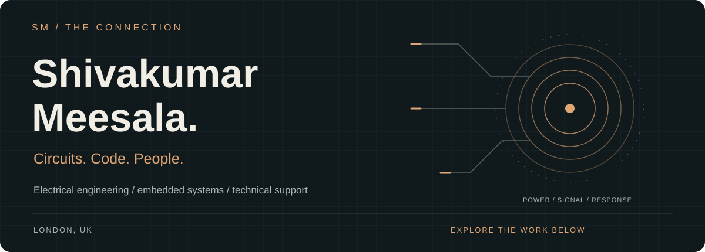
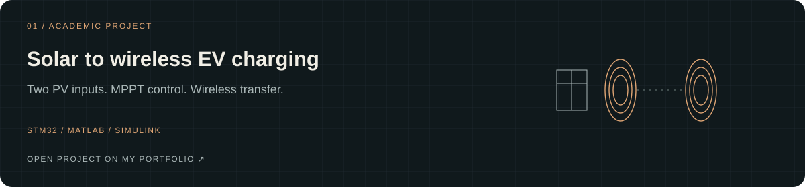
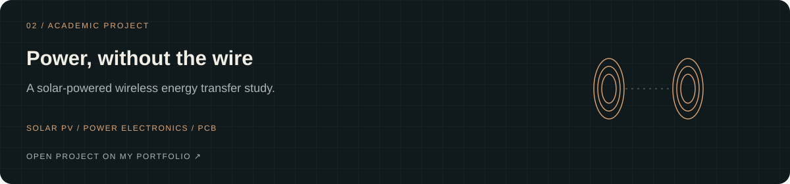
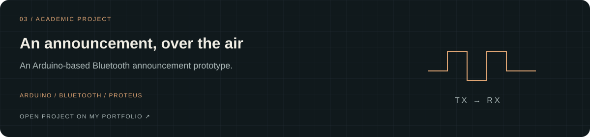
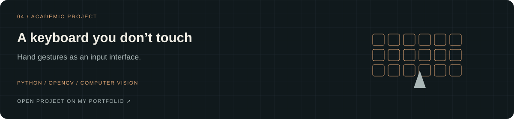

I’m Shiva, based in London. My academic work has taken me from solar charging and embedded systems to a keyboard controlled by hand gestures. Alongside that, I’ve worked in customer support at Amazon and B&M.

I like the part where something doesn’t work yet: tracing the problem, trying a fix, and explaining what happened.

[Portfolio ↗](https://shivakumarmeesala.space/) &nbsp; / &nbsp; [LinkedIn ↗](https://www.linkedin.com/in/meesala-shiva-kumar-447543341) &nbsp; / &nbsp; [Email ↗](mailto:Meesalashivakumar12@gmail.com)

### A few things I’ve worked on

These four academic projects are documented on my portfolio. The cards open that project collection; source files are not published in this repository yet.

<b>What I used, and what I’m doing now</b>

MATLAB / Simulink, STM32, Arduino, Proteus, PCB design, Python and OpenCV feature across my academic work. Project descriptions and context are on my portfolio.

I completed my MSc in Electrical and Electronics Engineering at Greenwich and I’m now studying Project Planning and Management at Bradford.

At Amazon Development Center (2022–2024), I supported international customers with account, access and transaction issues. Since September 2024, I’ve worked in customer service and store operations at B&M.

---

**I’m looking for my next step in electrical engineering, embedded systems or technical support.** If that fits your team, [send me a message](mailto:Meesalashivakumar12@gmail.com).
